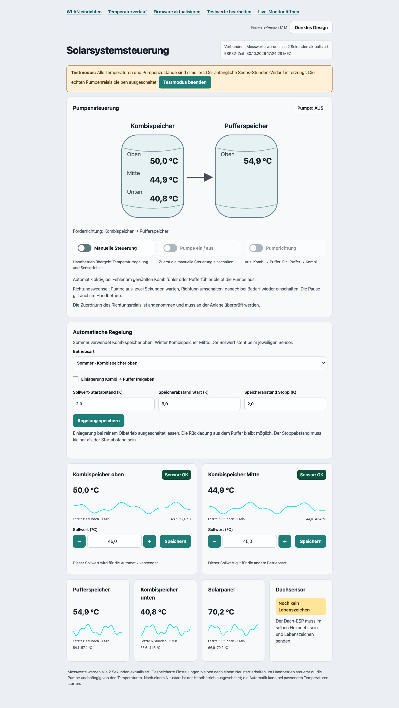

# Backload-Steuerung

ESP32-S3-Steuerung für Kombispeicher und Pufferspeicher mit Weboberfläche,
Simulationsmodus und Temperaturverlauf. Das optionale Temperaturarchiv läuft
separat auf einem Docker-Server.

Der Screenshot zeigt den Testmodus mit simulierten Temperaturen und Pumpenzuständen.

- [Firmware und Einrichtung](Backload/LIESMICH.txt)
- [Temperaturarchiv](history-server/README.md)
- [Tests](tests/)

Das Projekt ist für eine konkrete Heizungsanlage vorgesehen. Sensoranschlüsse,
Förderrichtung und Regelparameter müssen vor dem Einsatz an der Anlage geprüft
werden.
