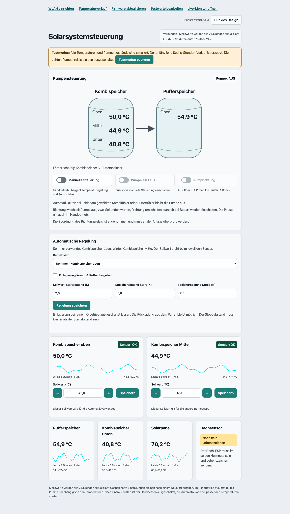

# Backload-Steuerung

ESP32-S3-Steuerung für Kombispeicher und Pufferspeicher mit Weboberfläche,
Simulationsmodus und Temperaturverlauf. Das optionale Temperaturarchiv läuft
separat auf einem Docker-Server.

Der Screenshot zeigt den Testmodus mit simulierten Temperaturen und Pumpenzuständen.

- [Firmware und Einrichtung](Backload/LIESMICH.txt)
- [Schaltbedingungen der Backload-Regelung](Documentation/Backload-Regelung.md)
- [Temperaturarchiv](history-server/README.md)
- [Tests](tests/)

Das Projekt ist für eine konkrete Heizungsanlage vorgesehen. Sensoranschlüsse,
Förderrichtung und Regelparameter müssen vor dem Einsatz an der Anlage geprüft
werden.

In Arduino IDE 2 die Datei Backload/Backload.ino öffnen.
Der gesamte Ordner Backload mit dem Unterordner src muss vorhanden sein.

Unter Werkzeuge einstellen:
- Board: ESP32S3 Dev Module
- Flash Size: 16 MB
- PSRAM: OPI PSRAM
- Partition Scheme: 16M Flash (3MB APP/9.9MB FATFS)
- Erase All Flash Before Sketch Upload: Disabled

Den ESP32-Core 2.0.13 über die Boardverwaltung installieren. Die zusätzlich
benötigten Bibliotheken liegen bereits in `Backload/src` und müssen nicht über
die Bibliotheksverwaltung installiert werden. Hinweise auf Updates global
installierter Bibliotheken ändern diese Kopien nicht. Die Arduino IDE kann
aktualisiert werden; danach den Build mit dem angegebenen Core prüfen.

Die mitgelieferten Versionen, Quellen und Anpassungen stehen in
[Backload/src/README.md](Backload/src/README.md).
